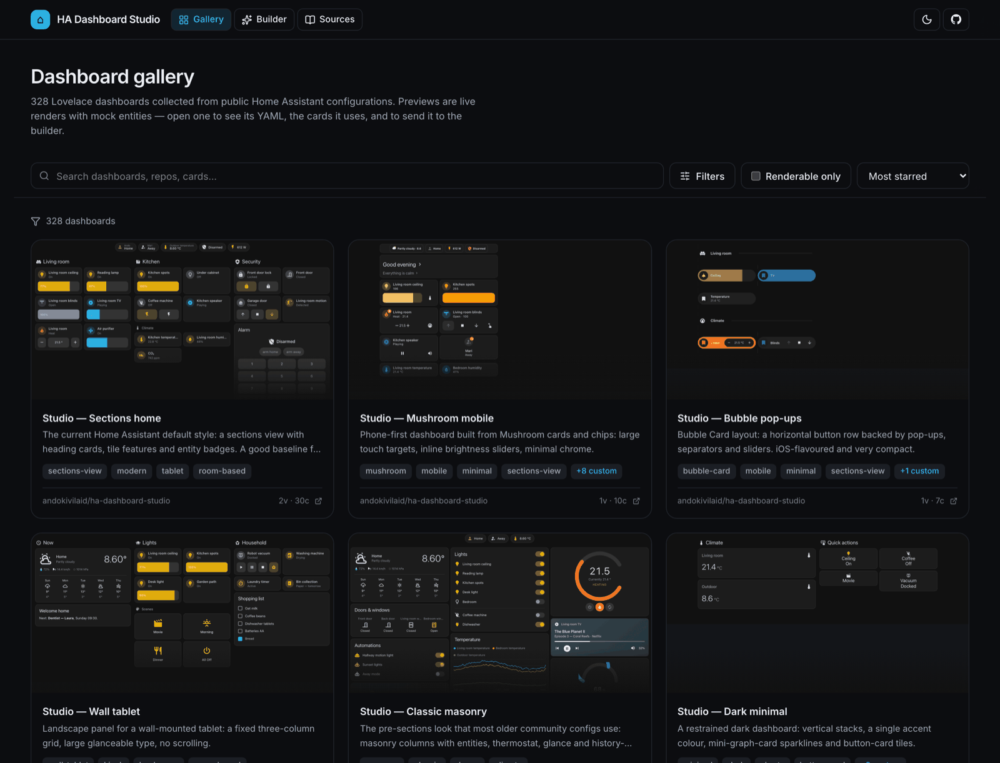
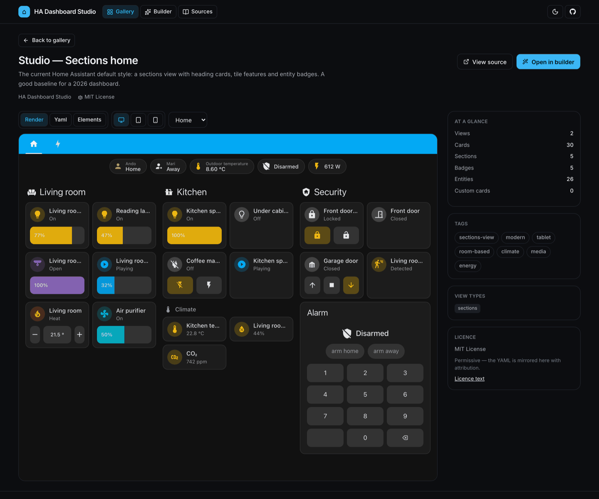
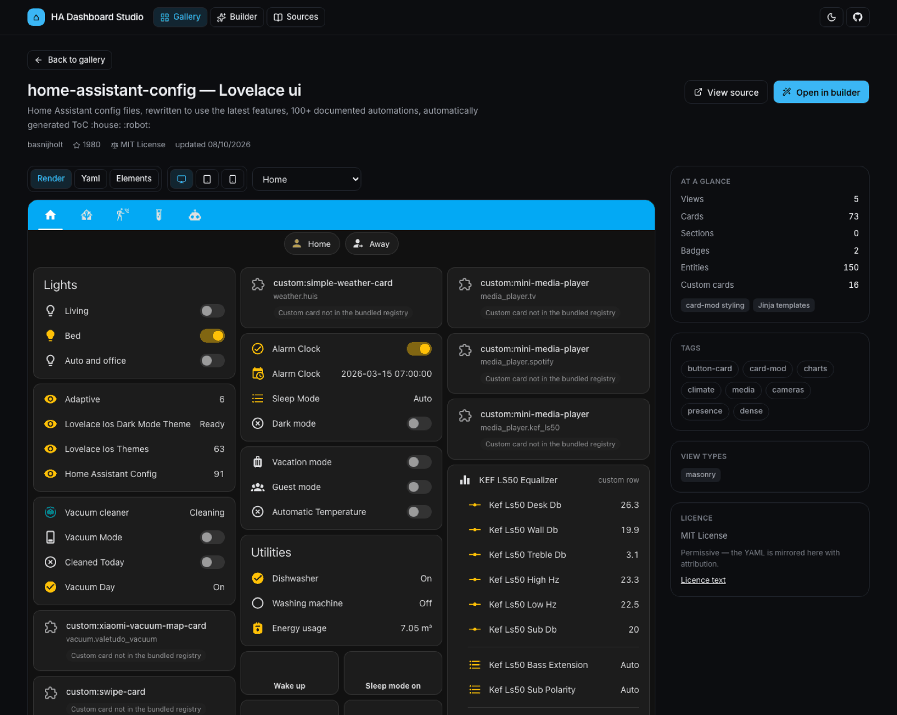
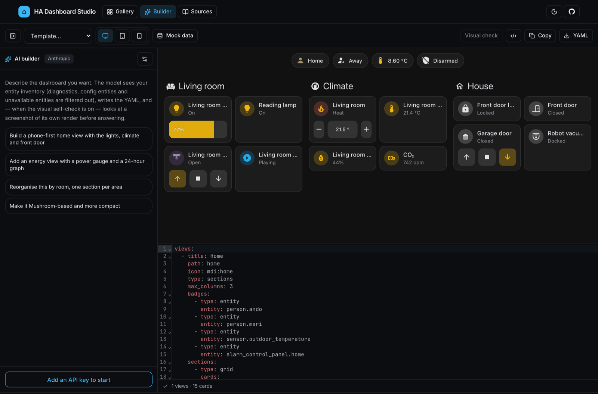

<div align="center">

# HA Dashboard Studio

**A searchable gallery of real Home Assistant dashboards, and an AI builder that renders them live.**

[](https://github.com/andokivilaid/ha-dashboard-studio/actions/workflows/ci.yml)
[](LICENSE)

[Live site](https://ha-dashboard-studio.vercel.app) · [Gallery](https://ha-dashboard-studio.vercel.app/gallery) · [Builder](https://ha-dashboard-studio.vercel.app/builder) · [Sources & licences](https://ha-dashboard-studio.vercel.app/sources)

</div>



---

Two things live in this repository.

**A gallery** of Lovelace dashboards collected from public Home Assistant
configurations on GitHub — searchable by card type, custom card, view type and
style, with every preview a **live render**, not a screenshot.

**A builder** that runs the dashboard rendering layer on its own: you describe
what you want, an LLM writes the YAML against your real entity inventory, the
result renders immediately, and — this is the interesting part — the model then
*looks at a screenshot of its own render* and fixes what it sees before handing
it back.

## Contents

- [What makes the previews real](#what-makes-the-previews-real)
- [The gallery](#the-gallery)
- [The builder](#the-builder)
- [Connecting a real Home Assistant](#connecting-a-real-home-assistant)
- [Architecture](#architecture)
- [Running it locally](#running-it-locally)
- [Testing](#testing)
- [Deployment](#deployment)
- [Design decisions and their limits](#design-decisions-and-their-limits)
- [Credits and licensing](#credits-and-licensing)

## What makes the previews real

Every card you see is rendered from the dashboard's actual YAML against a mock
`hass` object shaped exactly like the one the Home Assistant frontend passes to
cards.

- **Built-in cards** are implemented natively in `packages/lovelace-render`,
  against Home Assistant's own CSS custom properties
  (`--ha-card-border-radius`, `--state-light-active-color`, the lot). Tile with
  features, sections views with the 12-column grid, badges, heading cards,
  thermostat and light dials, weather with forecast, history graphs, gauges,
  media control, area cards, stacks, conditionals.
- **HACS custom cards execute for real.** Mushroom, Bubble Card, button-card,
  mini-graph-card, apexcharts-card, auto-entities, layout-card and card-mod are
  fetched, proxied and run as the actual web components the author published.
  A `custom:mushroom-light-card` in the gallery is a genuine Mushroom element
  with a shadow root, driven by the mock `hass`.
- **Anything unknown degrades gracefully** to a labelled placeholder that still
  names the card and its entity. A dashboard from 2019 using a card nobody has
  heard of still produces a readable preview.
- **Entities nobody else has are invented.** A harvested dashboard names
  `light.tv_lysa` and `sensor.varmepump_effekt`, which exist in exactly one
  house in the world. Rather than show a wall of "Unavailable", the renderer
  synthesises plausible state from the entity id — inferring that
  `sensor.kjokken_temperatur` is a temperature in °C and
  `binary_sensor.hallway_motion` is a motion detector, in several languages.
  Values are hashed from the id, so a dashboard looks the same on every render.
  The detail page says how many states were invented.



Here is a dashboard from a stranger's repository — 73 cards, 16 custom card
types, entity ids that exist in exactly one house — rendered in the browser:



## The gallery

```
328 dashboards · 152 with mirrored YAML · 156 repositories · 144 authors
4 983 cards · 140 built-in card types · 244 distinct HACS cards seen
```

The catalogue is built by `packages/catalog/scripts/ingest.ts`, which:

1. Searches GitHub for repositories by topic (`home-assistant-config`,
   `lovelace-ui`, `home-assistant-dashboard`, …) and by code
   (`filename:ui-lovelace.yaml`).
2. Walks each repository's git tree for files that plausibly hold a dashboard,
   skipping `custom_components`, `themes`, `blueprints` and friends.
3. Parses each candidate — tolerating Home Assistant's non-standard YAML tags
   (`!include`, `!secret`, `!include_dir_merge_list`) by quoting them so the
   dashboard still renders and the unresolved reference is shown to the reader.
4. Analyses it: card types, custom cards, view types, badges, entities,
   domains, card-mod usage, Jinja templates — and derives style tags
   (`mushroom`, `sections-view`, `wall-tablet`, `floorplan`, `energy`, …).

### The licence rule

**YAML is only mirrored when the upstream repository carries a permissive
licence** (MIT, Apache-2.0, BSD, ISC, Unlicense, CC0, 0BSD, Zlib). Copyleft or
unlicensed sources are catalogued as *metadata plus a link*: title, author,
stars, the full card inventory, and a pointer to the original. Forum and Reddit
posts are credited as places to look but never scraped.

`pnpm catalog:validate` fails the build if a single non-permissive entry ever
stores YAML, and CI runs it on every push. If you are an author who would
rather not be listed at all, open an issue — the entry is removed, no questions
asked.

## The builder



A three-pane workspace: chat on the left, live render in the middle, YAML
editor below. Everything is driven by the same renderer the gallery uses, so
what you see is what a real instance would show.

### Two data modes

**Mock** (default) — a deterministic demo home with 120+ entities across nine
areas and three floors, including climate, covers, media, cameras, scenes,
helpers and deliberately noisy diagnostics so entity-filtering can be tested.

**Live, read-only** — enter your instance URL and a long-lived access token and
the builder connects *from your browser* over the websocket API, reads states,
the entity/device/area/floor registries, your themes and your existing Lovelace
dashboards, and renders them. See [Connecting a real Home
Assistant](#connecting-a-real-home-assistant).

### The AI loop

```
you describe it
      ↓
entity inventory  ──→  generate YAML  ──→  render
(diagnostics,          (Claude / Gemini)      ↓
 config and                              screenshot the DOM
 unavailable                                  ↓
 entities removed)                       vision model critiques
                                              ↓
                                     corrected YAML applied
                                              ↓
                                   you see the result + the
                                   image the model looked at
```

- **Provider-pluggable.** Anthropic (`claude-opus-5-5` by default) and Google
  (`gemini-3.8-flash`). Bring your own key; it is stored in your browser and
  forwarded to the provider for exactly one request at a time. It is never
  logged and never persisted server-side — provider errors are redacted before
  they reach the response.
- **The generator prompt teaches current practice.** Models trained on older
  configurations reach for masonry views and `entities` cards; the system
  prompt pushes sections views, heading cards, tile features and
  `grid_options`, and forbids inventing entity ids.
- **The visual self-check** rasterises the live DOM with
  [`modern-screenshot`](https://github.com/qq15725/modern-screenshot) — which
  works in the browser, including on serverless hosting where a headless
  browser is not available — and sends the PNG to a vision model together with
  the YAML. The critique and the exact image the model saw are both shown in
  the chat, so you can disagree with it.

Every assistant and critic message carries a **Revert to this version** button.
The flow is described in more detail in [docs/ai-builder.md](docs/ai-builder.md).

## Connecting a real Home Assistant

The full guide is at [`/docs/connect`](https://ha-dashboard-studio.vercel.app/docs/connect). The short version:

1. Profile → Security → **Long-lived access tokens** → Create token.
2. Allow this origin in `configuration.yaml`, then restart:

   ```yaml
   http:
     cors_allowed_origins:
       - https://ha-dashboard-studio.vercel.app
       - http://localhost:3177
   ```

3. Your instance must be reachable over **HTTPS** from an HTTPS page (browsers
   block `https://` → `ws://`). Use Nabu Casa, a reverse proxy with a
   certificate, or run the studio locally and connect over plain HTTP.

### Read-only is enforced, not promised

`apps/web/src/lib/ha-connection.ts` holds an allow-list of websocket commands —
states, registries, config, themes, `lovelace/config`, `lovelace/resources`,
`subscribe_entities`. Anything else, including every `call_service`, throws a
`ReadOnlyViolation` **before it reaches the socket**. `hass.callService`,
`hass.callApi` and unlisted `hass.callWS` calls all reject, so a third-party
custom card that tries to toggle a light in the preview fails loudly rather
than changing your house.

## Architecture

```
ha-dashboard-studio/
├─ apps/web/                     Next.js 16 (App Router, React 19, Tailwind 4)
│  ├─ src/app/                   gallery, detail, builder, sources, docs
│  ├─ src/app/api/hacs/[slug]    proxies HACS bundles (CORS + MIME fix)
│  ├─ src/app/api/ai/*           generate + critique, user-supplied key
│  ├─ src/lib/ha-connection.ts   read-only websocket client
│  └─ src/lib/ai/                prompts and provider adapters
├─ packages/lovelace/            framework-free core
│  ├─ types.ts                   the HomeAssistant / Lovelace data model
│  ├─ yaml.ts                    tolerant parsing of HA's YAML dialect
│  ├─ analyze.ts                 card/entity/style extraction
│  ├─ registry.ts                the HACS bundle catalogue
│  └─ mock/                      the deterministic demo home
├─ packages/lovelace-render/     React implementation of the HA card set
└─ packages/catalog/             dashboards, schema, ingester, licence policy
```

### Why the HACS proxy exists

Most HACS cards ship as GitHub **release assets**, which are served as
`application/octet-stream` with no `Access-Control-Allow-Origin`. A browser
refuses to execute those as a module. `/api/hacs/[slug]` fetches them
server-side and re-serves them same-origin as `text/javascript`, cached for a
day, with the pinned upstream version in a response header. That is the whole
trick that makes third-party cards render.

### Why the icons are a webfont

A dashboard from the wild can reference any of MDI's 7 000+ glyphs. Bundling
`@mdi/js` would add roughly 2 MB of path strings to the client; the self-hosted
woff2 covers every icon in ~400 KB, loaded once.

## Running it locally

```bash
git clone https://github.com/andokivilaid/ha-dashboard-studio
cd ha-dashboard-studio
pnpm install          # postinstall copies the MDI webfont into apps/web/public
pnpm dev              # http://localhost:3177
```

Requires Node 20.11+ and pnpm 12. No environment variables are needed: AI keys
are entered in the UI, and the catalogue ships in the repository.

To rebuild the catalogue yourself:

```bash
GITHUB_TOKEN=$(gh auth token) pnpm catalog:ingest --max-repos 400
pnpm catalog:validate
pnpm catalog:bundle
```

## Testing

```bash
pnpm typecheck     # tsc across all four packages
pnpm test          # 194 unit tests (vitest)
pnpm build
pnpm test:e2e      # Playwright, incl. visual snapshots
```

**Unit tests** cover the YAML dialect (including anchors, aliases and every
`!include` variant), dashboard analysis and tag derivation, state formatting
and icon selection across every domain, the read-only guarantees of the mock
`hass`, entity-inventory filtering, prompt construction, YAML extraction from
model replies, the HACS registry, entity synthesis (including that it never overwrites a real entity and is
deterministic), the websocket allow-list that makes live connections
read-only, and the catalogue — including a test that **fails if any non-permissive entry ever
stores YAML**, and one that checks every curated dashboard only references
entities that exist.

**End-to-end tests** load the real built app and assert on the DOM the renderer
produces: tile features compute the right percentage, the entities card emits a
row per entity, the thermostat shows current and target temperature, badges
render, stacks nest, conditionals dim, unknown cards degrade to placeholders,
and **real Mushroom elements load through the proxy and reach `ready`**. The
builder suite drives the chat panel end to end against a stubbed provider and
asserts the visual self-check actually captures a PNG and displays it. Visual
snapshots cover the landing page, the gallery, two rendered dashboards, the
builder and the mobile layout.

## Deployment

Any Node host works. For Vercel, the repository is already shaped for it:
root directory `apps/web`, build command `pnpm build`, install command
`pnpm install`. Nothing in the deployment needs secrets.

## Design decisions and their limits

Being straight about what this is and is not:

- **This is not the Home Assistant frontend.** Running the real
  `home-assistant/frontend` bundle standalone means booting an application that
  expects an authenticated HA backend. Instead the built-in cards are
  reimplemented against the same design tokens and the same `hass` contract.
  They look right and behave right, but a card is a reimplementation, not the
  original. HACS cards, by contrast, *are* the originals.
- **Jinja templates are not evaluated.** There is no HA backend to evaluate
  them. `markdown` cards resolve simple `states('…')` calls and show the rest
  as an ellipsis; `custom:button-card` templates render as the card's own
  fallback.
- **History is synthetic.** Graph cards draw deterministic generated series, so
  screenshots are stable and the gallery needs no recorder database.
- **The gallery's card inventory is static analysis**, so a dashboard that
  builds cards through `auto-entities` filters reports the filter, not the
  cards it would produce.
- **Custom cards you installed yourself are not fetched from your instance.**
  Doing so would mean authenticating to your instance for static assets from
  the browser. Only the bundled registry runs; everything else falls back.

## Credits and licensing

This project is MIT licensed. It is **not affiliated with the Home Assistant
project**, Nabu Casa, or any of the custom card authors.

Every dashboard in the gallery belongs to its author and is listed with their
name, their repository and their licence. The HACS bundles are fetched from
their authors' own releases, unmodified, and each is credited with its licence
on the home page:

| Bundle | Author | Licence |
|---|---|---|
| Mushroom | [piitaya](https://github.com/piitaya/lovelace-mushroom) | Apache-2.0 |
| Bubble Card | [Clooos](https://github.com/Clooos/Bubble-Card) | MIT |
| button-card | [custom-cards](https://github.com/custom-cards/button-card) | MIT |
| mini-graph-card | [kalkih](https://github.com/kalkih/mini-graph-card) | MIT |
| apexcharts-card | [RomRider](https://github.com/RomRider/apexcharts-card) | MIT |
| auto-entities · layout-card · card-mod | [thomasloven](https://github.com/thomasloven) | MIT |

Material Design Icons are used under the Pictogrammers Free License.

See [CONTRIBUTING.md](CONTRIBUTING.md) to work on it, and
[`/sources`](https://ha-dashboard-studio.vercel.app/sources) for the full
provenance list.
